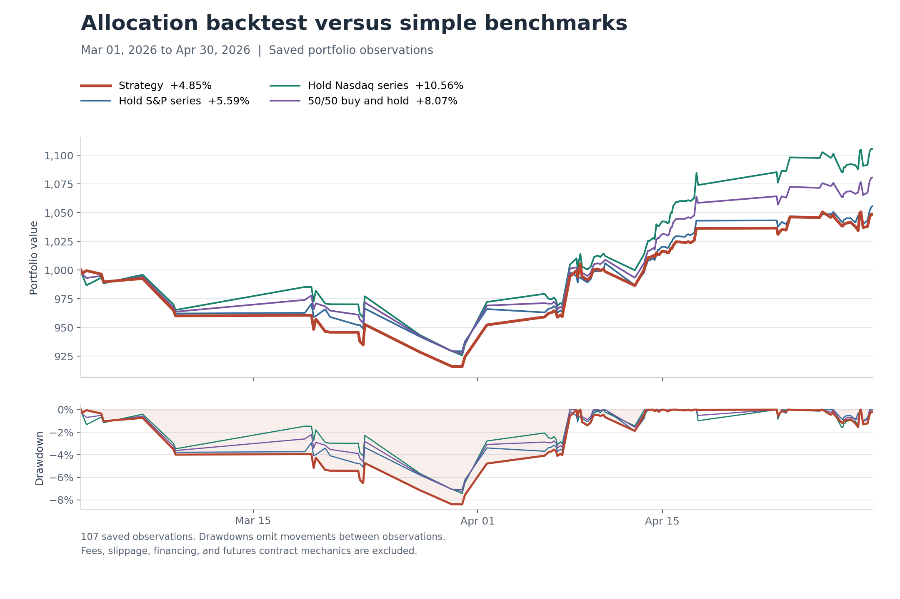

# Optimizer Backtest

A Python research project exploring portfolio allocation between two assets using
regime-conditioned Monte Carlo simulations and a LightGBM allocation model.
The original use case compares S&P 500 and Nasdaq indicator datasets.

At each change in the leader asset's extremum state, the backtest selects earlier
observations from similar market conditions, simulates price and relative-return
paths, ranks candidate allocations, and tracks the value of a rebalanced portfolio.

## Original experiment: March–April 2026

The allocation strategy underperformed both individual assets and a simple 50/50
portfolio in the saved experiment. This project documents that negative result
and the engineering behind its evaluation.

The original script configured training history from January 1, 2020 and a test
window of **March 1, 2026 through May 1, 2026, exclusive**. The saved portfolio has
107 observations, from **March 1 at 23:00 through April 30 at 23:00**, using the
source timestamps without an asserted timezone. The original configuration used
4,000 simulations per decision and a 96-hour horizon.



Regenerate this figure from the included portfolio CSV without rerunning simulations:

```bash
python plot_results.py
```

To chart a new run:

```bash
python plot_results.py --input outputs/portfolio.csv --output outputs/results_chart.png
```

The chart shows buy-and-hold baselines. The separately reported 50/50 rebalanced
baseline is included in the table below.

### Comparison over the saved observation window

All portfolios start at 1,000 units. Benchmarks use the same saved asset prices
and timestamps, without fees, financing, or contract mechanics.

| Portfolio | Final value | Total return | Maximum drawdown at saved observations |
| --- | ---: | ---: | ---: |
| Regime-based strategy | 1,048.49 | 4.85% | -8.40% |
| Hold S&P series | 1,055.91 | 5.59% | -7.07% |
| Hold Nasdaq series | 1,105.59 | 10.56% | -7.42% |
| 50/50 buy and hold | 1,080.75 | 8.07% | -7.25% |
| 50/50 rebalanced at regime points | 1,080.86 | 8.09% | -7.23% |

The strategy returned **4.85%**, trailing 50/50 buy and hold by **3.23 percentage
points**, with a larger observed drawdown. This run provides no evidence that the
added allocation complexity improved performance over these baselines.
Drawdowns use only the irregular rebalance observations and can miss losses
between them. Buy and hold starts each asset at its assigned initial weight and
allows weights to drift. The rebalanced 50/50 baseline restores equal weights at
each saved regime point. Benchmarks are calculated without cent-rounding at each
step; the original strategy rounds portfolio value at every rebalance.

### Allocation decisions and reported accuracy

The original console reported `Accuracy: 0.3644859813084112`, or 39 / 107. Its
`captured` flag counts whether the previously held asset outperformed the other
over the next observed interval. It also counts the initial, unevaluable row as
false. Excluding that row gives **39 / 106 = 36.79%**. There were no tied asset
returns and all allocations were either 100% leader or 100% follower in this run.
This is an interval-selection hit rate, not price-prediction accuracy or a measure
of statistical significance. Intervals differ in duration and return magnitude.

The strategy switched assets **50 times**. The reported runtime was **2 hours,
53 minutes, 14 seconds**, from the original console output. Costs were not
modeled, so the turnover adds a further unmeasured implementation cost.

### Interpretation and remaining questions

The observed result is underperformance, not an identified cause. The saved
portfolio alone cannot establish whether regime matching, relative-return
simulation, the allocation model, or signal timing caused it. Useful follow-up
experiments would compare LightGBM against direct ranking of simulated mean
returns, examine simulated versus realized returns, and test other periods
without selecting settings on their outcomes.

Source: the preserved [original portfolio output](results/original_backtest.csv)
and the matching console log supplied with the experiment. Every
saved portfolio transition reconciles to previous-weight accounting with the
original cent-rounding convention. These are **original research results**;
the refactored pipeline has not yet been rerun on the historical indicator files.
The saved portfolio CSV is included so the reported benchmark comparison can
be checked. Reproducing the full simulation still requires the source indicator
data, which is not included.

## Run locally

Use Python 3.10 or newer:

```bash
python3 -m venv .venv
source .venv/bin/activate
python -m pip install -r requirements.txt
python optimizer_backtest.py \
  --leader data/leader_indicators.csv \
  --follower data/follower_indicators.csv \
  --start-train 2020-01-01 \
  --start-test 2026-03-01 \
  --end-test 2026-05-01 \
  --paths 4000 \
  --output-dir outputs
```

Input data is supplied separately. The files must contain `timestamp`, `close`,
`high`, `low`, `ath`, `path`, `last`, and `latest`. The loader also accepts
`last_extrema_path` and `latest_extrema_path` in place of the short extrema names.
`ath` denotes the all-time-high reference; `path` and extrema columns are the
precomputed normalized regime features consumed by the existing simulation engine.
This project does not currently provide an end-to-end raw-price indicator pipeline.

Use one consistent timezone convention across both files and the command-line
boundaries. Timestamps must be unique, and both assets need an observation at each
rebalance timestamp. Training data must include sufficient history for the
engine's 60-day exclusion window and regime matching.

The default simulation horizon is 96 hours. Add `--save-simulations` to save a
separate pair of path files at each rebalance. Simulation files can be large.
Monte Carlo processing currently uses ten worker processes and has no guarantee
of identical output across runs.

## Project structure

| File | Purpose |
| --- | --- |
| `optimizer_backtest.py` | CLI, walk-forward orchestration, portfolio accounting |
| `backtest_data.py` | CSV normalization and chronological splitting |
| `optimizer_mc.py` | Existing regime-conditioned simulation engine |
| `simulation_utils.py` | KDE sampling, regime windows, timestamps, and extrema state |
| `size_by_beta.py` | Relative-return conversion and allocation ranking |
| `plot_results.py` | Plot portfolio values and observed drawdowns from saved results |
| `regime_matching.py` | Normalized feature distances for regime matching |
| `tests/test_backtest.py` | Data, accounting, and orchestration checks |
| `tests/test_simulation.py` | Regime matching, return conventions, and synthetic simulation checks |
| `results/original_backtest.csv` | Saved original portfolio observations underlying the results |

The source tree contains the paired-asset allocation backtest and its numerical
helpers. Live-trading integrations, older single-asset experiments, unused plotting
functions, and generated Monte Carlo dumps have been removed.

## Methodology and output

1. Load each dataset once, sort timestamps, and normalize legacy column names.
2. Select rebalance points from changes in the leader's `last` indicator.
3. At each point, train using rows strictly earlier than that timestamp.
4. Generate paired leader and follower-relative paths with the existing engine.
5. Fit LightGBM to simulated terminal portfolio returns over a 5% allocation grid.
6. Apply the previous allocation's realized returns, then record the new weights.

`outputs/portfolio.csv` includes timestamps, weights, asset prices, cumulative
asset returns, and portfolio value. Legacy names `spy_*` and `qs_*` refer to the
leader and follower respectively. `spread` is the difference in realized interval
returns. `captured` is a legacy directional-exposure flag; it is **not** a validated
prediction-accuracy measure, particularly when both asset weights are positive.

## Assumptions and limitations

- Portfolios are fully invested, long-only, and frictionless. Fees, slippage,
  futures margin, contract multipliers, rolls, and financing are not modeled.
  Futures-derived data is treated as a synthetic price series, not an executable
  futures-account simulation.
- Signals and executions use the same observation. This assumes the indicator
  is available at that price and can overstate executable results.
- Chronological splitting alone does not establish absence of look-ahead bias.
  Precomputed extrema, all-time highs, and other indicators need a separate audit
  to verify that they use only information available at each historical timestamp.
- The existing simulation engine's return and beta definitions are preserved.
  Their financial interpretation and statistical calibration need independent
  validation; this refactor does not establish strategy profitability.
- Value is recorded at rebalance points, rounded to cents each time, and stops at
  the last rebalance. It is not marked to the requested test-period end.
- KDE sampling needs sufficient, non-degenerate historical observations. Missing
  regimes or numerical failures can stop the run; there is no fallback strategy.

The original experiment above is a descriptive result from one period.
A permitted sample dataset, an indicator-timing audit, explicit transaction costs,
and additional evaluation periods remain necessary for a stronger empirical study.

## Verification

```bash
python -m unittest discover -s tests -v
```

The tests check split boundaries, previous-weight accounting, timestamp alignment,
relative-return compounding, allocation ranking, and regime-match boundaries.
A small synthetic integration test runs the actual paired simulation engine with
serial dispatch in place of the process pool. The orchestration tests stub only
the simulation and allocation responses. Tests do not validate model performance
against market data or establish reproducibility across worker processes.

### Code maintenance

```bash
python -m pip install -r requirements-dev.txt
python -m black --check .
python -m ruff check .
```

Formatter and lint settings cover the backtest modules and tests.

The numerical helpers are organized by purpose in `simulation_utils.py` and
`regime_matching.py`. Unused compatibility wrappers, older extrema algorithms,
single-asset simulation variants, and trading utilities have been removed.

The numerical formulas, strict minimum-match boundary, clipping bounds, and
no-match sentinel are preserved. They document the original experiment and
remain subjects for a separate modeling review.

## Preparing the GitHub repository

The `.gitignore` uses an explicit allowlist for the backtest sources, tests,
development settings, and original portfolio results. Input datasets and generated
simulation output are not staged by default.
Review `git status` and the staged diff before publishing; ignore rules do not
protect files already tracked or explicitly force-added. Add a license after
choosing the terms under which you want to share the code.
